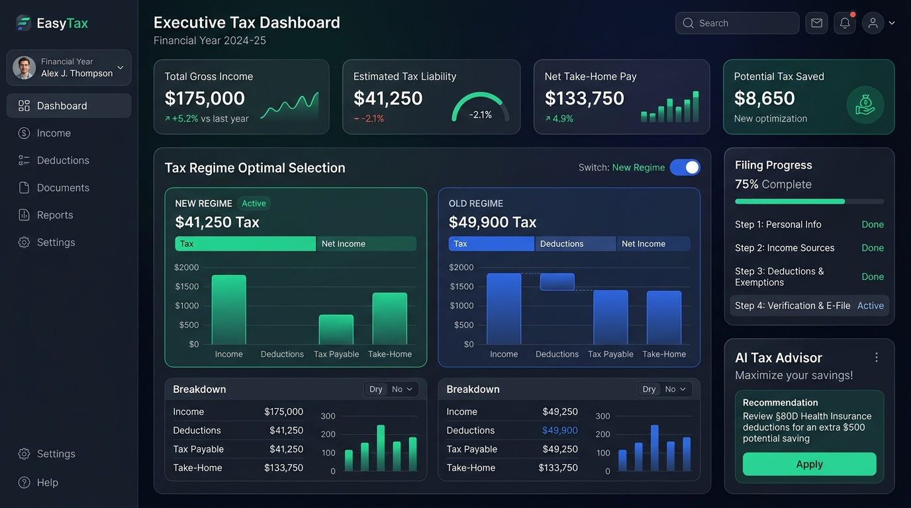

# ◈ EasyTax — Enterprise Tax Management & Filing Platform

[](https://nextjs.org/)
[](ROADMAP.md)
[](docs/adr/0001-init-architecture-and-learning-system.md)
[](docs/learning/concepts/01-enterprise-software-mindset.md)

An enterprise-ready tax calculation, advisory, and filing application built with modern software engineering practices, deterministic financial calculations, and a high-trust user experience.

---

## 🎯 Dual-Track Philosophy (Product + Learning)

EasyTax serves a dual purpose:
1. **Track A (The Product)**: A production-grade, multi-role (Taxpayer, Accountant, Auditor, Admin) financial application with zero-error tax calculation, automated regime optimization (Old vs New Regime), and secure document filing.
2. **Track B (The Learning Journey)**: A hands-on engineering laboratory documenting real-world software craftsmanship—from design systems and pure functional math to relational ACID transactions, security hardening, and CI/CD pipelines.

```mermaid
graph LR
    subgraph Track A: Product Engineering
        A0[Phase 0: Foundation] --> A1[Phase 1: Design & UI Wizard]
        A1 --> A2[Phase 2: Core Tax Engine]
        A2 --> A3[Phase 3: Secure API & DB]
        A3 --> A4[Phase 4: Document Vault]
        A4 --> A5[Phase 5: CI/CD & Deploy]
    end
    subgraph Track B: Engineering Mastery
        B0[Git & ADRs] --> B1[Design Tokens & UX]
        B1 --> B2[TDD & Precision Math]
        B2 --> B3[Relational Modeling & RBAC]
        B3 --> B4[Async Queues & PII]
        B4 --> B5[Docker & Automation]
    end
    Track A -.-> Track B
```

---

## 🖥️ Target UI: Executive Tax Dashboard



### Key Interface Highlights
- **Executive KPI Cards**: Real-time Gross Income, Estimated Tax Liability, Net Take-Home Pay, and Tax Saved.
- **Side-by-Side Regime Comparator**: Live visual comparison between Old and New Tax Regimes with dynamic breakdown charts.
- **Multi-Step Guided Filing**: Step-by-step wizard reducing cognitive burden for complex tax disclosures.
- **AI Tax Advisor Widget**: Contextual deduction suggestions (e.g., Section 80D, HRA optimization).

---

## 🗂️ Project & Knowledge Navigation

| Resource | Description | Path |
| :--- | :--- | :--- |
| **Project Roadmap** | Full 6-phase development & engineering milestones | [`ROADMAP.md`](ROADMAP.md) |
| **Developer DevLog** | Daily session notes, blockers, breakthroughs, and code logs | [`docs/learning/devlog.md`](docs/learning/devlog.md) |
| **Skill Tracker** | Self-assessment matrix across Frontend, Backend, DB, Security & DevOps | [`docs/learning/skill_matrix.md`](docs/learning/skill_matrix.md) |
| **Architecture Records** | Formal Architecture Decision Records (ADRs) | [`docs/adr/`](docs/adr/) |
| **Concept Deep Dives** | 1-page engineering concept summaries (ACID, Tokens, TDD) | [`docs/learning/concepts/`](docs/learning/concepts/) |
| **Design Specifications** | Wireframes, color tokens, and UI component specifications | [`docs/design/`](docs/design/) |

---

## 🏛️ Core Engineering Principles

1. **Zero Financial Drift**: Never use floating-point types for currency calculations. All tax arithmetic uses exact integer math (cents/paise) or precise decimal structures.
2. **Design-Driven Development**: UI is designed first to discover the exact domain fields, validation rules, and user interaction states before building backend models.
3. **Defense in Depth**: Role-Based Access Control (RBAC), audit trails, and strict PII protection built-in from the ground up.
4. **Documentation as Code**: Every architectural pivot is captured in an ADR; every new concept is added to the learning library.

---

## 🚀 Development Workflow

This repository adheres to the **Conventional Commits** specification:
- `feat(...)`: New user-facing feature or component
- `fix(...)`: Bug fix in calculation, UI, or data handling
- `docs(...)`: Documentation updates, DevLog entries, or ADR additions
- `style(...)`: CSS/design system token adjustments
- `test(...)`: Unit, integration, or end-to-end tests
- `chore(...)`: Repository maintenance, dependencies, or configuration
